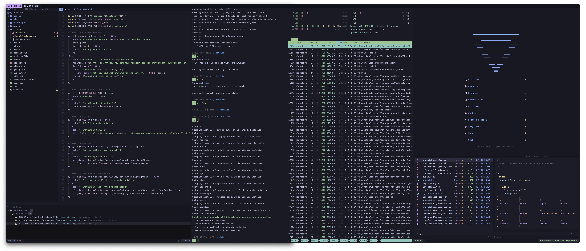

# Personal System Configuration

This repository manages my `macOS` settings. It uses [`mise`][mise] and custom [`Zsh`][zsh] scripts.

The configuration includes keyboard shortcuts for launching apps, managing windows, and editing text. These shortcuts work best with my [custom keyboard layout][keyboard-layout].



## Machine setup

Clone the repository and initialize a machine:

```bash
git clone --single-branch --branch main git@github.com:minusfive/dot.git ~/dev/personal/dot
cd ~/dev/personal/dot
./scripts/install-mise.zsh
source scripts/mise-env.zsh
mise bootstrap
```

- The [`./scripts/install-mise.zsh`](./scripts/install-mise.zsh) installs `mise` when it is not available and checks the supported installation. On success it prints the commands for next steps.
- Sourcing [`scripts/mise-env.zsh`](./scripts/mise-env.zsh) adds `mise` to `$PATH` and selects the repository-scoped `mise` configuration.
- The `mise` `bootstrap` command asks for approval before it changes `macOS` preferences, places files, installs tools and applications, and clones repositories. The selected profile is validated before profile-sensitive phases.
- Use `mise bootstrap --dry-run` to preview changes without applying them.
- The `mise` [`bootstrap`](./scripts/tasks/bootstrap.zsh) task updates the cleanup inventory, removes stale links, and applies repository fixes after the bootstrap.
- If a phase fails, fix the reported phase, then rerun `mise -E <profile> bootstrap` with the same profile.

### Profiles

The `work` profile is the default and excludes personal-only tools and applications. To apply the `personal` profile, run:

```bash
mise -E personal bootstrap
```

You can also set the profile with `MISE_ENV`:

```bash
MISE_ENV=personal mise bootstrap
```

The selected profile is saved at `${XDG_STATE_HOME:-$HOME/.local/state}/minusfive/profile`.

[`Hammerspoon`](./home/.config/hammerspoon/) reads the same state file through the [`ProfileState Spoon`](./home/.config/hammerspoon/Spoons/ProfileState.spoon/init.lua) so it can customize keyboard shortcuts and other automations for the selected profile. The `hs.settings` interface stores the profile in `macOS` defaults under a custom key, so other applications can read it.

Each repository path selects a local identity and credential profile for [`Git`](https://git-scm.com/). The personal domain list has a tracked source. Work domains, identity data, and authentication settings stay outside this repository. The read-only `pre-commit` check blocks credential helpers and unapproved host settings in tracked files. See [`Git` credential profiles](./docs/git-credentials.md) for setup and migration.

### File ownership and application data

The `home/` directory mirrors the target user's `$HOME` layout. `mise` places selected files where the corresponding tool or application expects to find them, including `mise` itself. A placed file can be a link, a copy, or an edit of an existing file.

The [`dotfiles`][mise-dotfiles], [`bootstrap.files`][mise-bootstrap], and [`bootstrap.directories`][mise-bootstrap] entries describe how and when `mise` manages files and directories.

`mise` supports several ways to define how files are managed. This repository primarily uses the following types:

- A `symlink` links one file directly to the repository. Edits at the installed path change the repository file and appear as repository changes. Edits made by external tools to linked files appear as repository changes. Those changes are then checked by hooks, and reviewed by agents and myself, before every commit.
- `symlink-each` links every file that it finds in a source directory. It does not copy files that exist only at the target. Repository-only files need explicit exclusions.
- A `copy` creates a regular target file from a source file. `block` and `line` edits can then manage selected parts of that target without making it a link.
- A `template` dynamically creates a target output file from a source file and arbitrary inputs. Edits to the output do not change the source.
- A `block` manages text between marker comments. A `line` manages one exact line. Both leave the rest of the target unchanged.
- A `merge` can update specific entries or values in a target file without managing the whole file. Combined with `template` those values can be dynamically rendered from other inputs.

This file management model leaves generated histories, caches, databases, credentials, and other sensitive files in their original location, untracked, outside this repository.

The files are grouped by purpose. Each module manages related resources. A `dotfiles` entry can manage a whole file or selected configuration values. This keeps each setup area small and easier to understand. Repository-only guidance or maintenance files can stay co-located with managed files without polluting target locations.

```text
.
├── .agents/                         # repository-only guidance, skills, and evaluation files
├── AGENTS.md                        # repository instructions
├── .mise/                           # repository-local tools and tasks
├── assets/                          # images
├── home/                            # files mirrored under ~/
│   ├── .agents/
│   │   ├── agents/                  # reusable global agent profiles
│   │   └── skills/                  # global agent skills
│   ├── .config/
│   │   ├── 1Password/
│   │   ├── BetterDisplay/
│   │   ├── ...
│   │   └── mise/
│   │       ├── conf.d/              # per-tool module files
│   │       │   ├── 1password.toml
│   │       │   ├── agents.toml
│   │       │   ├── bat.toml
│   │       │   └── ...
│   │       ├── config.toml
│   │       ├── mise.lock
│   │       ├── miserc.toml
│   │       ├── tasks/
│   │       └── utils/
│   ├── .ssh/
│   │   └── config                   # ~/.ssh/config
│   └── AGENTS.md                    # global agent instructions
├── scripts/                         # setup and development tasks
├── tests/                           # script tests
└── ...
```

#### Global agent instructions, profiles, and skills

The repository keeps global agent instructions, profiles, and skills in `home/`. The `mise` agents module deploys the shared source tree. Harness-specific modules link profiles to the global locations that each tool scans. This keeps one source file for each profile while supporting each tool's file naming and directory rules.

The root `AGENTS.md` and `.agents/` directory are repository-only. They guide work in this repository and are not deployed as global files.

`mise` tasks keep the root and `home/` skill indexes synchronized. They validate the global skill evaluation files and check for name conflicts between repository-only and global skills. The `hk` check and pre-commit hooks run these validations with the other repository checks.

## Development

The repository manages the tools used for development. When you enter the repository, `mise` activates its project tools.

Run the setup task to install project dependencies and add automatic `hk` checks to `mise`:

```sh
mise run setup
```

Run all configured checks:

```sh
mise run check
```

The [`hk` configuration](./hk.pkl) defines the checks and fixes in one place. Markdown checks preserve the existing line wrapping and reformat paragraphs that use hard line breaks. The repository also permits selected inline HTML.

## Previous `Nix` configuration

I previously maintained a configuration based on [`Nix`][nix-config]. I no longer maintain it because `mise` now provides many of the features I used from `Nix`.

[keyboard-layout]: https://github.com/minusfive/zmk-config
[mise]: https://mise.jdx.dev
[mise-bootstrap]: https://mise.jdx.dev/bootstrap.html
[mise-dotfiles]: https://mise.jdx.dev/dotfiles.html
[nix-config]: https://github.com/minusfive/dot/tree/nix
[zsh]: https://www.zsh.org/
